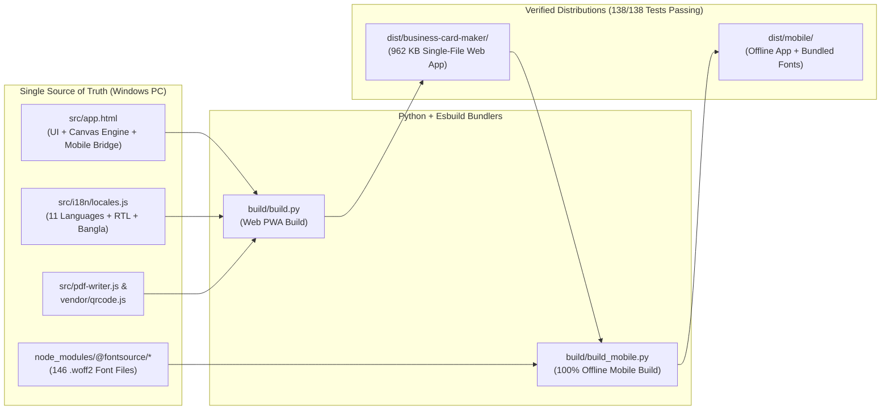
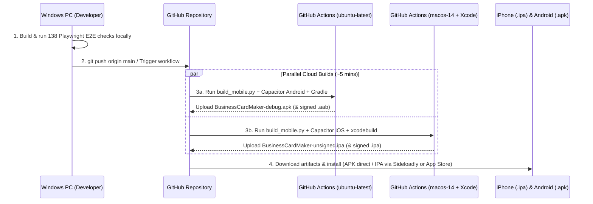

# Executive Presentation: Building a Global Multi-Language Business Card Maker & Native iOS/Android Apps from Windows

> [!NOTE]
> This presentation is structured so you can walk your boss through the project slide-by-slide—covering **business value**, **technical architecture**, **11-language unification**, **IP-based auto-localization**, **mobile-native features**, and how you engineered an **automated cloud pipeline to build iOS (`.ipa`) and Android (`.apk`) apps from a Windows PC**.

---

## Slide-by-Slide Presentation Deck

````carousel
### Slide 1: Executive Overview & Business Value
**Project**: Free Business Card Maker (`com.aiinfos.businesscardmaker`)  
**Goal**: Deliver a zero-cost, print-shop-grade business card design studio that works on the web and as a native iOS & Android app—in 11 languages, 100% offline-capable, with zero server database risk.

| Metric | Achievement | Business Impact |
| :--- | :--- | :--- |
| **Card Designs** | **148 vector templates** (8 classic + 140 across 35 styles) | Matches paid SaaS tools at \$0 recurring server cost |
| **Languages** | **11 global languages** (including Bangla & Arabic RTL) | Instant global reach across Asia, Europe, Americas & MENA |
| **Print Quality** | **300 DPI CMYK-ready PDF** with 3 mm bleed & safe-zone guides | Ready for professional offset/digital print shops |
| **Platforms** | **Web PWA + Native iOS (`.ipa`) + Native Android (`.apk`/`.aab`)** | Single codebase serving Desktop, Mobile Web, iOS & Android |
| **Automated QA** | **138 / 138 End-to-End Playwright checks passing** | Zero regressions across Desktop, iPhone, and Offline builds |

**Speaker Notes for Your Boss:**
> *"I built and evolved our Business Card Maker from two separate language editions into a single, unified global product that supports 11 languages, detects a user's country by IP to switch languages automatically, and compiles into native iOS and Android mobile apps—all developed and orchestrated from my Windows PC."*
<!-- slide -->
### Slide 2: Core Studio Architecture (Zero Dependencies, 300 DPI Precision)
Instead of relying on heavy third-party frameworks or paid cloud rendering APIs, the studio runs 100% on the user's device:

- **HTML5 Canvas 2D Vector Engine ([`src/app.html`](file:///d:/AiInfos/business-card-maker/src/app.html))**:
  - Draws 148 designs procedurally at any resolution—interactive screen preview with 3D pointer tilt on desktop and 3D flip animation on phones, scaling up to **300 DPI** with optional **3 mm bleed** and trim/safe-zone lines on export.
- **Custom Binary PDF 1.4 Writer ([`src/pdf-writer.js`](file:///d:/AiInfos/business-card-maker/src/pdf-writer.js))**:
  - Generates a 2-page (Front & Back) print-ready PDF with `/TrimBox` and `/BleedBox` metadata directly in browser memory.
- **Smart Contact QR & Digital Wallets**:
  - Encodes UTF-8 `vCard 3.0` contact cards (including LinkedIn, X, Facebook, Instagram, YouTube, TikTok, and GitHub handles) directly into the back QR code, plus **Apple Wallet**, **Google Wallet**, and `.vcf` contact export.
- **Strict SHA-256 Content-Security-Policy ([`build/build.py`](file:///d:/AiInfos/business-card-maker/build/build.py))**:
  - Computes SHA-256 cryptographic hashes of inline scripts at build time so no unauthorized script can ever execute.

**Speaker Notes for Your Boss:**
> *"Because all rendering and PDF generation happen directly on the device, our hosting cost is practically zero, page loads are instantaneous, and user privacy is guaranteed by design."*
<!-- slide -->
### Slide 3: Unifying Bangla + 11 Global Languages into One Codebase
Previously, English and Bangla lived in separate folders/builds. I unified them into a single multi-language engine ([`src/i18n/locales.js`](file:///d:/AiInfos/business-card-maker/src/i18n/locales.js)) and expanded support to **11 languages**:

1. **English (`en`)** · 2. **বাংলা (`bn`)** · 3. **Français (`fr`)** · 4. **Deutsch (`de`)** · 5. **Español (`es`)** · 6. **हिन्दी (`hi`)** · 7. **日本語 (`ja`)** · 8. **简体中文 (`zh`)** · 9. **繁體中文 (`zh-Hant`)** · 10. **العربية (`ar` - full RTL)** · 11. **Русский (`ru`)**

- **100% Feature Parity for Bangla (`bn`)**:
  - Preserved all 6 curated Bengali font pairings (*Noto Sans Bengali*, *Noto Serif Bengali*, *Hind Siliguri*, *Anek Bangla*, *Baloo Da 2*, *Tiro Bangla*, *Galada*), Bengali numeral formatting (`০–৯`), and full Bangla translations of all 148 design names, 20 color palettes, UI controls, and the About & FAQ guide.
- **Automatic RTL/LTR Layout Switching**:
  - Selecting Arabic (`ar`) dynamically switches `dir="rtl"` across the entire workbench while keeping card canvas coordinates accurate.
- **Smart Sample Data Replacement**:
  - Switching languages automatically updates the default sample card (e.g., *Alex Rahman* in English -> *আরিফ রহমান* in Bangla) without overwriting any custom text the user has already typed.

**Speaker Notes for Your Boss:**
> *"Instead of maintaining 11 separate codebases, we now maintain a single source of truth. Every new feature we add is immediately available in English, Bangla, Arabic, Spanish, French, German, Hindi, Japanese, Chinese, and Russian."*
<!-- slide -->
### Slide 4: Smart IP-Based Automatic Language Switching
To give international visitors a native experience on their very first visit—without annoying popups or blocking page load—I implemented a **3-tier language resolution pipeline**:

```
Priority 1: Explicit User Choice (?lang= URL param or saved language selector choice)
   ↓ (if not set by user)
Priority 2: Non-blocking Geo-IP Country Lookup (6-hour localStorage cache)
   ├── Primary: https://api.country.is (1,500 ms timeout)
   └── Fallback: https://get.geojs.io/v1/ip/country.json
   ↓ (maps 45+ country codes: BD → bn, FR/BE/MC → fr, DE/AT/CH → de, ES/MX/AR → es, IN → hi, JP → ja, CN → zh, TW/HK → zh-Hant, SA/AE/EG → ar, RU → ru)
Priority 3: Browser navigator.languages fallback → Default English (en)
```

- **Zero First-Paint Delay**: The app boots immediately and runs the IP check asynchronously in the background.
- **Polite, Dismissible Notification**: When the app auto-switches based on IP, a subtle toast notifies the user in their language with a `×` button, and manual selections via the header `#langSelect` dropdown permanently take precedence.

**Speaker Notes for Your Boss:**
> *"When someone opens the app from Dhaka, Paris, Tokyo, or Riyadh, it automatically switches to their language in the background without slowing down the initial load—and if they prefer another language, one click in the top bar locks in their preference."*
<!-- slide -->
### Slide 5: Upgrading to a True Native Mobile App Experience
Rather than just wrapping a website in a frame, I added **four mobile-first capabilities** tailored for phones:

1. **Full-Screen "Present Card / QR" Mode (`#presentModal`)**:
   - One tap on **Present** opens a high-contrast modal showing the front and back of the card plus a large, crisp vCard QR code so anyone you meet in person can scan your contact in one second, alongside quick **Share PDF** and **Save contact (.vcf)** buttons.
2. **"My Cards" Multi-Card Deck (`#deckWrap`)**:
   - Users can save, update, switch between, and delete up to **25 different cards** on their device (e.g., Personal Card, Work Card, Bangla Card, English Card), persisted to `localStorage` and mirrored to native `@capacitor/preferences`.
3. **100% Offline Font & Asset Bundler ([`build/build_mobile.py`](file:///d:/AiInfos/business-card-maker/build/build_mobile.py))**:
   - Bundles all **146 `.woff2` Latin & Bengali font files** into `dist/mobile/fonts/` so all 27 font families render 100% offline (even in Airplane Mode).
4. **Native iOS/Android Share Sheet & Haptics**:
   - Uses `@capacitor/filesystem` + `@capacitor/share` to open the native iOS Share Sheet (AirDrop, Save to Files, Print, WhatsApp) and Android Share Sheet, plus `@capacitor/haptics` for tactile feedback on card flips and tab switches.

**Speaker Notes for Your Boss:**
> *"On a phone, users don't just design cards—they use the app in person to share their contact details and manage multiple cards for different roles or languages, even when completely offline."*
<!-- slide -->
### Slide 6: How I Built an iOS & Android App from a Windows PC
**The Challenge**: Apple requires macOS and Xcode to compile iOS `.ipa` apps, and buying dedicated Mac hardware just for builds adds unnecessary cost.  
**The Solution**: I combined **Capacitor 6** ([`capacitor.config.json`](file:///d:/AiInfos/business-card-maker/capacitor.config.json)) with a **GitHub Actions Cloud CI/CD Pipeline** ([`.github/workflows/mobile-apps.yml`](file:///d:/AiInfos/business-card-maker/.github/workflows/mobile-apps.yml)):

- **Local Development on Windows**:
  - Edit source code, build the offline mobile bundle (`python build/build_mobile.py`), and run 138 automated Playwright browser & mobile viewport tests (`node tests/smoke.test.js`) locally on Windows.
- **Parallel Cloud Compilation on GitHub Actions**:
  - **Job 1 (`ubuntu-latest` Linux Runner)**: Installs Java 21 + Android SDK + Capacitor Android, generates adaptive launcher icons & splash screens from `public/icons/icon-512.png`, and compiles `BusinessCardMaker-debug.apk` (plus signed `.aab`/`.apk` when keystore secrets are present).
  - **Job 2 (`macos-14` Apple Silicon Runner)**: Installs Xcode + CocoaPods + Capacitor iOS, configures `Info.plist` permissions, generates iOS icon sets, and compiles **`BusinessCardMaker-unsigned.ipa`** (for free sideloading from Windows via Sideloadly/AltStore without needing a \$99/yr Apple account immediately) + **`BusinessCardMaker-Simulator.app.zip`**, and automatically builds a signed App Store `.ipa` when Apple Developer secrets are added.

**Speaker Notes for Your Boss:**
> *"Even though I work on a Windows PC, we don't need to buy a Mac to build our iPhone app. Every time we push or click 'Run workflow' on GitHub, GitHub's cloud spins up both a Linux server for Android and a macOS server with Xcode for iOS, handing us ready-to-install `.apk` and `.ipa` files in about 5 minutes."*
````

---

## Architecture & Pipeline Diagrams

### 1. Unified Multi-Language + Offline Mobile Build Pipeline


### 2. Windows PC to iOS (`.ipa`) & Android (`.apk`) Cloud CI/CD Workflow

