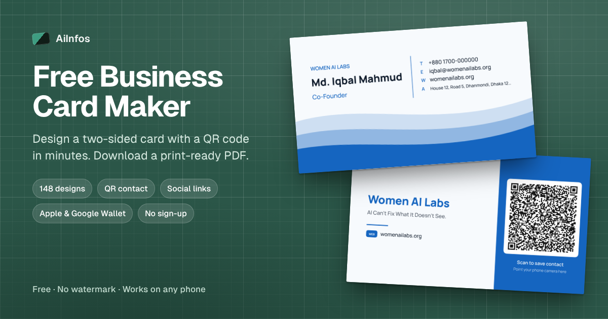

# Free Business Card Maker with QR Code, Wallet Pass and Print-Ready PDF

A free, open-source **business card maker** by [AiInfos](https://aiinfos.com), in **English and Bengali**. Design a two-sided business card in the browser, add a **vCard QR code** and **social links**, download a **300 dpi print-ready PDF** with bleed, and save the card to **Apple Wallet or Google Wallet**. No sign-up, no watermark and no image files: every design is drawn in code, and each edition is a single HTML page.

**Live:** [English](https://iqbalmahmud.com/business-card-maker/) · [বাংলা](https://iqbalmahmud.com/bangla-business-card-maker/)



## Features

- **148 card designs:** 8 classic layouts plus 140 designs in 35 styles (waves, gold frames, botanical, low-poly, circuit, confetti and more). The design browser previews every design with your own details, with search, categories and 12 designs per page
- **Professional back (default):** logo, tagline and social links on the paper side, with a large QR code on a color panel. Four more back styles: solid, lines, dots and light
- **Social links:** LinkedIn, X, Facebook, Instagram, YouTube, TikTok and GitHub. Type a username or paste a link; the card prints a short address anyone can type (`linkedin.com/in/yourname`), with a neutral label tag instead of company logos
- **Your own letters:** designs that show letters (initials, or a company monogram such as "WA" or "উএ") get a field to change them, up to 4 characters
- **QR code:** a vCard (scan to save the contact, with social links) or a website link. Long codes switch to a lower error-correction level so each dot prints larger, and the app warns when a code gets very dense
- **13 typefaces** (English): Montserrat, Poppins, Inter, Roboto, Raleway, Nunito, Oswald, Playfair Display, Lora and Merriweather, plus Syne, Cormorant and Manrope, each paired with a matching body font. Fonts load only when needed, so the page stays fast
- **20 color palettes** plus custom accent, paper and ink colors; adjustable size and weight for every text element
- **Print-ready PDF:** front and back, 300 dpi, optional 3 mm bleed, TrimBox and BleedBox set for print shops; PNG of each side
- **Sizes:** 3.5 × 2 in (88.9 × 50.8 mm), 85 × 55 mm and 90 × 55 mm, with trim and safe-zone guides
- **Apple Wallet and Google Wallet:** free through each wallet's built-in tools, or one-tap passes with the included PHP script and your own credentials ([server/WALLET-SETUP.md](server/WALLET-SETUP.md))
- **Phone app layout:** on phones the page works like a mobile app: a top bar, the card pinned under it with a front/back switch, one screen per section and a bottom tab bar (Details, Design, Style, Back, Download). Nothing else is pinned, so nothing overlaps
- **Fast, modern interface:** on computers, a sticky section bar with the preview pinned beside the form; dark mode on both, and reduced motion when the device asks for it
- **About & FAQ on demand:** the help article, how-to and FAQ open in a popup from the **?** button (a bottom sheet on phones that closes with ×, Esc, a swipe down or the back button). The page itself ends with a one-line credit footer (built by, inspired by)
- **Install button with text:** "Install app" on computers, a compact "Install" with a phone icon on phones
- **Installable app** that works offline; designs saved only in the visitor's browser for 30 days
- **Bengali edition:** fully Bengali interface, help text, SEO and card captions, with 6 popular Bengali fonts ([details](#bengali-edition-বাংলা-সংস্করণ))

## Repository layout

```
free-business-card-maker/
├── src/
│   ├── app.html               # the app: HTML, CSS and JavaScript (English source)
│   ├── pdf-writer.js          # writes the print-ready PDF in the browser
│   ├── sw.template.js         # service worker (offline use)
│   └── i18n/
│       ├── bn.py              # turns the English build into the Bengali edition
│       └── about-bn.html      # Bengali help text and FAQ
├── vendor/qrcode-generator/   # QR code library (MIT), inlined into each page
├── build/
│   ├── build.py               # builds every edition into dist/
│   ├── editions.json          # public editions: address, default details, storage key
│   ├── editions.local.example.json   # template for private copies (git-ignored)
│   ├── pwa.py                 # install button and iPhone install hint
│   └── minify.js              # minifies the built page (esbuild)
├── public/                    # icons, manifest and social preview images
├── server/
│   ├── api/                   # wallet.php (Apple and Google Wallet passes)
│   ├── deploy/                # nginx.conf and htaccess.txt for production (copied to dist/server-setup/)
│   └── WALLET-SETUP.md
├── tools/
│   ├── serve.js               # local preview server
│   ├── og-image.js            # regenerates the social preview images
│   └── font-route.js          # real fonts for tests and images, offline
├── tests/smoke.test.js        # end-to-end checks in a real browser
├── bangla-repo/README.md      # README for the separate Bangla repo
└── .github/workflows/         # CI and release automation
```

## Build and run

You need **Node.js 18+** and **Python 3.8+**.

```bash
git clone https://github.com/YOUR-USERNAME/free-business-card-maker.git
cd free-business-card-maker
npm install
npm run build        # builds every edition into dist/
npm run serve        # http://localhost:8080/business-card-maker/ and /bangla-business-card-maker/
```

Each folder in `dist/` is a complete site: upload it as it is. The matching server settings and wallet guide are in `dist/server-setup/<folder>/`; they don't go on the web.

| Command | What it does |
| --- | --- |
| `npm run build` | Builds all editions, minified, with a pre-compressed `index.html.gz` |
| `npm run build:dev` | Same, but readable (not minified) |
| `python3 build/build.py en` | Builds only the editions you name (`en`, `bn`, or your own) |
| `npm test` | Browser tests for the English and Bengali editions (run `npx playwright install chromium` once first) |
| `npm run og-images` | Redraws `public/og-image.png` and `public/og-image-bn.png` from the real app |

## Editions

Each edition is one entry in `build/editions.json`:

```json
"en": {
  "folder": "business-card-maker",
  "lang": "en",
  "site": "https://iqbalmahmud.com/business-card-maker/",
  "index": true,
  "storageKey": "cardpress.iqbal.v1",
  "cachePrefix": "bcm-iqbal",
  "alternate": "bn",
  "example": { "name": "Md. Iqbal Mahmud", "title": "Co-Founder", "...": "..." }
}
```

- `site` is the public address, used in the canonical link, social tags, structured data and the server settings in `deploy/`.
- `example` holds the details shown on first visit.
- `index: false` keeps a copy out of Google.
- `alternate` links the English and Bengali pages to each other.

**Private copies** (with a real phone number or home address) go in `build/editions.local.json`, using the same format. Git ignores that file, so private details never reach GitHub. Copy `build/editions.local.example.json` to start.

**Updating installed copies.** When you release a new version, bump `VERSION` in `src/sw.template.js` so phones that installed the app pick it up.

## Bengali edition (বাংলা সংস্করণ)

The Bengali page is generated from the English source at build time by `src/i18n/bn.py`, so every fix and feature reaches both languages. Every translated string must match the English source; if the source changes and a translation no longer matches, the build stops instead of shipping half-English text.

- **Everything in Bengali:** buttons, help text, design and color names, categories, contact labels (ফোন, ইমেইল, ওয়েব, ঠিকানা), the QR caption on the card, the FAQ and the search-engine tags. Interface numbers use Bengali digits; phone numbers stay as typed so they still dial.
- **6 popular Bengali fonts** from Google Fonts (free, open licence), in five styles:

  | Style | Headings | Body text |
  | --- | --- | --- |
  | আধুনিক (modern) | Anek Bangla | Anek Bangla |
  | ঐতিহ্যবাহী (traditional) | Tiro Bangla | Noto Serif Bengali |
  | পরিচ্ছন্ন (clean) | Noto Sans Bengali | Noto Sans Bengali |
  | গোলগাল (rounded) | Baloo Da 2 | Baloo Da 2 |
  | শৈল্পিক (artistic) | Galada | Noto Sans Bengali |

  Hind Siliguri is left out on purpose: its Bengali digit one (১) is a small raised hook that reads like a comma, so "১৪৮" looks like "‘৪৮".
- **Search in either language:** "ঢেউ" and "waves" both find the wave designs.
- **SEO:** Bengali title, description, FAQ structured data and social image, `lang="bn"`, and `hreflang` links between the two languages.

## Bangla repo

A second repository, `bangla-business-card-maker`, gives the Bengali edition its own GitHub page with a Bengali README, so it's found by people searching in Bengali. **Don't edit it by hand:** it's updated automatically from this repo.

One-time setup:

1. Create an empty public repository named `bangla-business-card-maker`.
2. Create a fine-grained personal access token (GitHub → Settings → Developer settings → Fine-grained tokens) with access to **that repository only** and **Contents: Read and write**.
3. In **this** repository, go to Settings → Secrets and variables → Actions:
   - add a **secret** `BANGLA_REPO_TOKEN` with the token
   - add a **variable** `BANGLA_REPO` with `YOUR-USERNAME/bangla-business-card-maker`
4. Optional: in the Bangla repo, turn on GitHub Pages (Settings → Pages → Deploy from branch `main`, root) for a free live copy.

Then publish a release here (Releases → Draft a new release, for example `v1.1.0`). The **Release** workflow:

1. builds and tests both editions,
2. attaches a ready-to-upload zip of each edition to the release,
3. pushes the Bengali build and `bangla-repo/README.md` to the Bangla repo.

You can also run it by hand from the Actions tab (**Release → Run workflow**). Until the token and variable are set, it simply skips step 3.

## Continuous integration

Every push and pull request runs **Build and test**: it builds both public editions and runs the browser tests on a computer and a phone screen size. That covers drawing, the section bar (computer) and the tab bar (phone, including checks that the top bar, card and tab bar never overlap), the design browser, the letters field, social links, the Light back, the PDF, the About & FAQ popup (opens, fits the screen, closes with Back and Esc; footer is the credit line only), the free wallet route, script errors, the Content Security Policy (nothing blocked) and, in the Bengali edition, untranslated English. The built site is kept as a download on the workflow run for 14 days.

## Deploying

Upload a folder from `dist/` (or a zip from a release) to your site, for example as `/business-card-maker/`. On WordPress this works without changes, because the web server serves real files before WordPress handles the request.

### Production and high traffic

Every card is designed, drawn and exported in the visitor's own browser, so the server only sends files. Opening the page never runs PHP; `api/wallet.php` runs only when someone taps a wallet button.

**Tested:** with these nginx settings on a 2-core server, 15 seconds of traffic gave **154,983 visits to the English edition and 144,411 to the Bengali one** (about 10,000 per second), with no errors; 99% of requests were answered within 24 ms. Each visit downloads about 50 KB (55 KB for Bengali). On a slow 4G phone the page shows in about 0.4 seconds.

1. **Use the server settings** from `dist/server-setup/<folder>/` (the build writes each edition's folder path into them). Nginx or CloudPanel: add the blocks from `nginx.conf` to your site. Apache, LiteSpeed or cPanel: copy `htaccess.txt` into the app folder as `.htaccess`. They turn on compression, serve the pre-compressed page, set cache and security headers, and block private files.
2. **Put Cloudflare (free plan) in front of your site.** Your server's bandwidth is the real limit without it: 10,000 visits in 15 seconds is about 290 Mbps.
3. **Keep `index.html.gz` in sync.** It's rebuilt with every build. If you edit `index.html` by hand on the server, delete `index.html.gz`.
4. **Wallet passes** are limited to 30 per visitor per hour, 1,000 a day in total and 2 at a time (`api/config.php`). Behind Cloudflare, enable the real-IP lines in `nginx.conf`.

### Embedding in another page

The app can also run inside an `<iframe>` (a page builder, a preview pane). It detects this and adapts:

- **Fixed-height frame** (the frame scrolls on its own): works as on a normal page.
- **Auto-height frame** (the host makes the frame as tall as its content, so the outer page scrolls): the layout stops using screen-height units, dialogs and messages open next to the button that was tapped, the computer preview follows the visible part of the frame, and on phones the tab bar sits under the card instead of at the bottom of the screen.

Linking to the page directly still gives the best experience, especially on phones.

### Static hosts

GitHub Pages, Netlify, Vercel and Cloudflare Pages: publish a folder from `dist/`. They can't run PHP, so the wallet buttons use the free route (each wallet's built-in tools), which needs no server.

## Security

Summary: a strict Content Security Policy on every page, no HTML from user input, checked storage, and a wallet script that only your own pages can use, with limits, image checks and private temp files. Server settings block keys, backups and dot files and add security headers. Details, and how to report a problem: [SECURITY.md](SECURITY.md).

## Apple Wallet and Google Wallet

Passes must be signed with keys only you hold, so they're created on your server by `api/wallet.php` (PHP 8, no Composer packages). Follow [server/WALLET-SETUP.md](server/WALLET-SETUP.md) for the certificates and keys. Never commit `server/api/config.php` or key files; `.gitignore` already excludes them.

Without that setup, the buttons show the card's contact QR code with steps for **Create a Pass** in Apple Wallet (iOS 27 and later) and **Everything else** in Google Wallet, plus a **Save contact (.vcf)** button.

## SEO

- Title, description, canonical URL, Open Graph and Twitter tags, 1200 × 630 preview image
- `WebApplication` and `FAQPage` structured data matching the visible FAQ, with author and contributor credits
- Crawlable help text, how-to and FAQ in each language, in the page's HTML from the first load (shown in the About & FAQ popup, so search engines still read it); `hreflang` tags pairing English and Bengali for search engines (no visible language switch: each edition stands on its own); a sitemap per edition

When you change a preview image, run `npm run og-images`, bump `OG_VERSION` in `build/build.py`, rebuild, then refresh the preview in Facebook's [Sharing Debugger](https://developers.facebook.com/tools/debug/) and LinkedIn's [Post Inspector](https://www.linkedin.com/post-inspector/).

## How it works

- Cards are drawn on an HTML `<canvas>` in millimetres and rendered at 300 dpi for export.
- The PDF is written directly in the browser (one JPEG per page, with TrimBox and BleedBox); no PDF library.
- QR codes come from [qrcode-generator](https://github.com/kazuhikoarase/qrcode-generator), inlined into the page.
- Fonts load from Google Fonts without blocking the first paint, and the cards redraw when they arrive.
- The design browser opens instantly and paints its previews a few per frame.
- Phone layout: below 880 px wide, each settings group belongs to one tab (`data-tab` in `src/app.html`); the tab bar shows one tab's groups at a time. Add a new group by giving it a `data-tab` value.

## Contributing

Issues and pull requests are welcome. Change the source in `src/`, run `npm run build` and `npm test`, and open a pull request; CI runs the same checks. For text changes in the Bengali edition, edit `src/i18n/bn.py` or `src/i18n/about-bn.html`.

Ideas: more layouts, a sheet of several cards per page for home printing, CMYK-friendly color presets and more languages (a new language is one file like `bn.py`).

## Credits

- Built by [Iqbal Mahmud](https://www.IqbalMahmud.com), main developer. A free tool by [AiInfos](https://aiinfos.com).
- Inspired by [Dawn C Simmons](https://www.DawnCSimmons.com), who suggested the idea.
- Third-party code, fonts and trademarks: see [THIRD-PARTY-NOTICES.md](THIRD-PARTY-NOTICES.md).

## License

[MIT](LICENSE)
